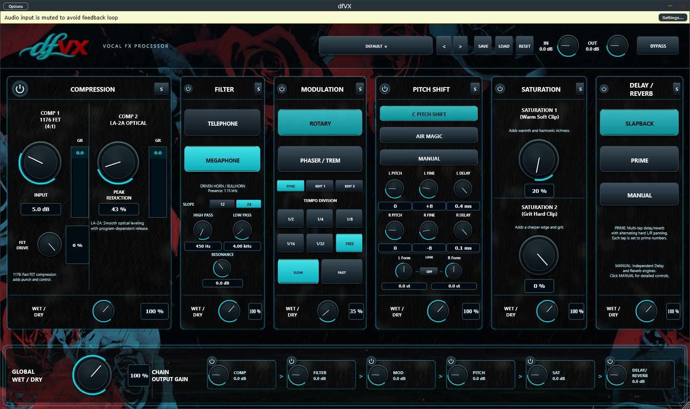

# dfVX — Kisatchie Audio

**dfVX** is a Windows x64 VST3 vocal-effects processor developed by **Kisatchie Audio**.



## Download dfVX for Windows

**Version 0.1.0 — initial Windows VST3 build**

[Download dfVX 0.1.0 for Windows (VST3 ZIP)](https://github.com/user-attachments/files/34610014/dfVX-0.1.0-Windows-VST3-x64.zip)

**Release 0.1.0** is available through the files linked in the [GitHub release](https://github.com/Quiescent18/dfVX-downloads/releases/tag/v0.1.0).

Download the **Windows VST3 ZIP** (not the automatically generated GitHub “Source code” archives). The ZIP contains the complete `dfVX.vst3` bundle, installation README, and release notes. No standalone app is included.

## Installation

1. Download the ZIP and extract it completely.
2. Close your DAW.
3. Copy the entire `dfVX.vst3` directory to `C:\Program Files\Common Files\VST3`. Administrator permission may be required.
4. Restart your DAW and rescan VST3 plugins if necessary. Find **dfVX** by **Kisatchie Audio**.

For updates, close your DAW before replacing the complete VST3 bundle. User presets are stored separately at `Documents\dfVX\Presets`.

## User manual

[Download color illustrated dfVX user manual (PDF)](https://github.com/user-attachments/files/34610720/dfVX_User_Manual_Updated.pdf)

## Features

- Two-stage compression: FET and optical processing.
- Telephone and megaphone filtering.
- Rotary, phaser, and tremolo modulation.
- Stereo pitch shifting and vocal thickening.
- Warm, grit, and aggressive saturation character.
- Delay and reverb.
- Factory presets and saved user presets.

## About version 0.1.0

This initial Windows x64 VST3 build was produced by the November 8, 2026, successful Windows build workflow, including its pitch DSP smoke test. Compatibility across individual DAWs has not been independently validated. Windows binaries are **not digitally signed**.

## Release files and verification

- [Color illustrated user manual (PDF)](https://github.com/user-attachments/files/34610720/dfVX_User_Manual_Updated.pdf)
- [Version 0.1.0 release](https://github.com/Quiescent18/dfVX-downloads/releases/tag/v0.1.0)
- [All releases and future updates](https://github.com/Quiescent18/dfVX-downloads/releases)
- [SHA-256 checksum file](https://github.com/user-attachments/files/34610013/SHA256SUMS.txt)

To verify the ZIP, use Windows PowerShell:

```powershell
Get-FileHash .\dfVX-0.1.0-Windows-VST3-x64.zip -Algorithm SHA256
```

Compare the result to `SHA256SUMS.txt` on the release page.

The public download repository contains installation information and release binaries only, **not** the dfVX source code, development libraries, `.exp` files, or the internal test application. Retain any supplied third-party notices. All third-party components remain subject to their respective license terms.

Copyright © 2026 Kisatchie Audio. All rights reserved.
